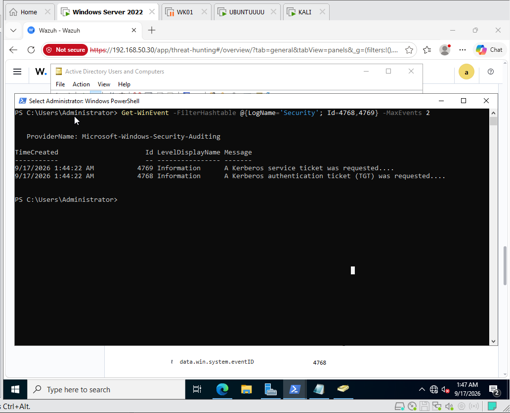
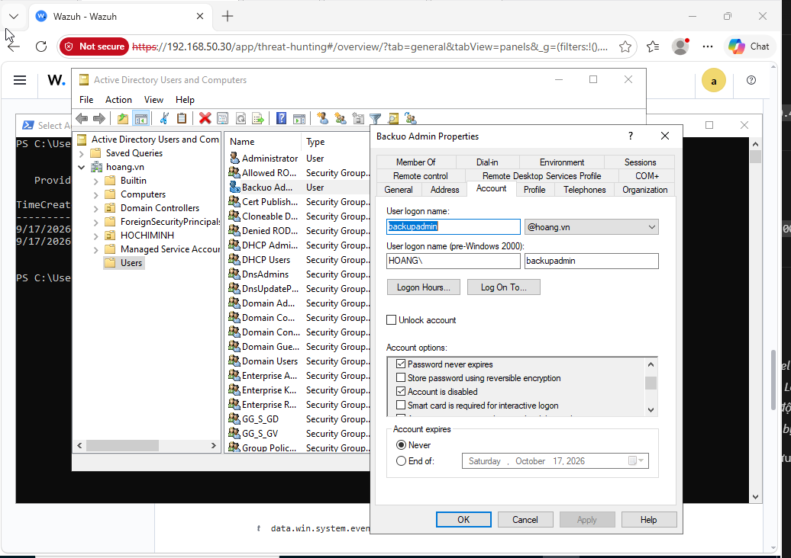

# Kerberos Detection and Account Response

I used Windows Security events to investigate Kerberoasting and AS-REP Roasting signals, then added a Python integration for Telegram notification and an optional LDAP account response.

[Back to the lab](../README.md)

## Setup

The recorded environment used VMware Workstation, Wazuh 4.8 and the `hoang.vn` domain.

| Host | Role | Address |
| --- | --- | --- |
| `DC01` | Windows Server 2022 Domain Controller | `192.168.50.10` |
| `SIEM-SRV` | Ubuntu 22.04 Wazuh Manager | `192.168.50.30` |
| `KALI` | Impacket `GetNPUsers.py` and `GetUserSPNs.py` | `192.168.50.40` |

Enable Success/Failure auditing for `Kerberos Authentication Service` and `Kerberos Service Ticket Operations` on the DC. Directory Service Access auditing and the relevant object SACL are needed for Event 4662.

Use [local_rules.xml](local_rules.xml) on the Manager. Install [requirements.txt](requirements.txt) into the integration's Python environment and place [custom-soar.py](custom-soar.py) at `/var/ossec/integrations/custom-soar.py` with the appropriate Wazuh ownership and executable permissions.

Configure the Wazuh integration to use `custom-soar.py`, JSON alert format and rule IDs `100100,100101`. Rule `100102` is detection-only in this configuration.

The integration reads these environment variables:

| Variable | Use |
| --- | --- |
| `TELEGRAM_BOT_TOKEN`, `TELEGRAM_CHAT_ID` | Notification destination |
| `DOMAIN_CONTROLLER_IP` | DC address; use its certificate-matching FQDN for LDAPS |
| `DOMAIN_ADMIN_USER`, `DOMAIN_ADMIN_PASS`, `AD_BASE_DN` | LDAP bind identity, secret and search base |
| `AD_USE_LDAPS=true`, `AD_LDAP_CA_FILE` | Enable TLS and supply a trusted CA file when needed |
| `AD_ALLOW_ACCOUNT_DISABLE=true` | Opt in to AS-REP account disablement; default is notification only |
| `AD_EXCLUDED_IDENTITIES` | Comma-separated additions to the built-in exclusions |

The bind-variable name is retained for compatibility; use a dedicated identity with only the required delegated rights. With LDAPS enabled, certificate verification is required. Without it, the lab connection uses LDAP on port 389. LDAP connect/receive and Telegram HTTP timeouts are five seconds.

## Detection

- `100100`: Event 4769 with RC4-HMAC (`0x17`), a Kerberoasting signal that can also reflect legacy service use.
- `100101`: Event 4768 with no pre-authentication and RC4. An AS-REP is encrypted with a key derived from the user's password, which permits an offline cracking attempt against a captured response.
- `100102`: Event 4662 with the replication-right GUID. Legitimate DC replication can match; the alert needs subject-account and authorization review.

These single-event conditions do not establish an attack by themselves. The [companion quality lab](https://github.com/LeeHoang26/wazuh-detection-quality-lab) examines false positives and missing context.

## Response

Kerberoasting produces a notification without disabling the service account. Automatically disabling every roasted service identity could interrupt services.

AS-REP disablement requires the explicit opt-in. The script normalizes UPN and `DOMAIN\user` names, escapes LDAP search values and refuses ambiguous results. Built-in exclusions, the bind identity, machine accounts and `adminCount=1` accounts are protected; configured exclusions are merged with those defaults.

The LDAP write sets only `ACCOUNTDISABLE` with `current_uac | 0x0002`. The script checks the operation result and reads UAC back before reporting success. Lookup, write, readback and delivery failures are explicit. Missing source IPs remain unknown.

## Evidence

The recorded Impacket run requested ticket material from DC01:


Events 4768 and 4769 were generated in the DC's Security log:



Wazuh matched both credential-access rules:

| Kerberoasting `100100` | AS-REP `100101` |
| --- | --- |
|  |  |

The recorded response disabled `backupadmin`, changing UAC from `4260352` to `4260354`, while `john` and target SPN `sqlservice` remained active:

| Disabled account | Account retained |
| --- | --- |
|  |  |


These images show the ticket requests, alerts and account-state observations used for this scenario.

## Testing

From the repository root:

```powershell
python -m unittest discover -s kerberos-detection-soar/tests
```

The tests use mocked LDAP and HTTP results. To verify deployment, confirm Windows audit events, Manager rule matches, integration failures and UAC readback in an isolated domain. Sync the test client's clock with the DC before Impacket requests to avoid `KRB_AP_ERR_SKEW`.

## Limits

The exclusions do not cover every privileged group, service dependency or business-critical identity. Account changes still need an approved IAM policy and delegated permissions. A notification does not apply perimeter blocking or re-enable pre-authentication.

The rules need frequency and environmental context before operational use. Event 4662 replication access is particularly unsuitable for automatic account disablement without checking whether replication is authorized.
