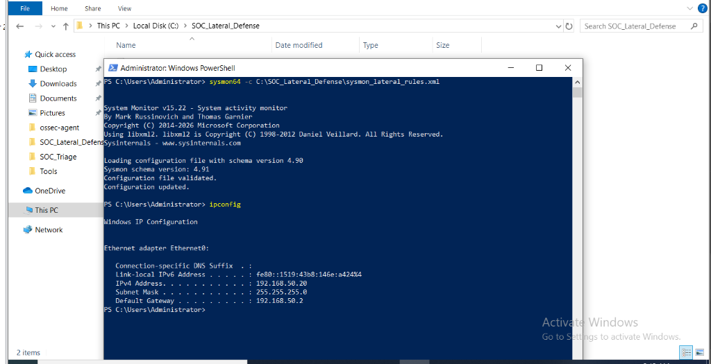
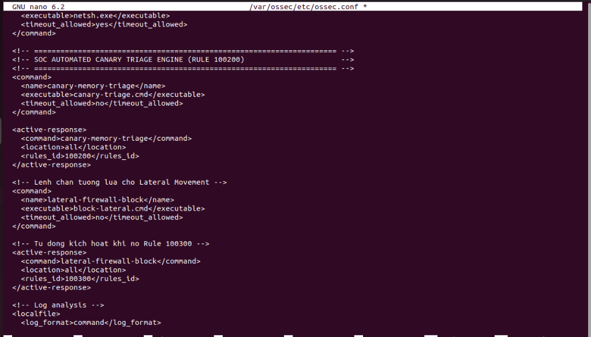
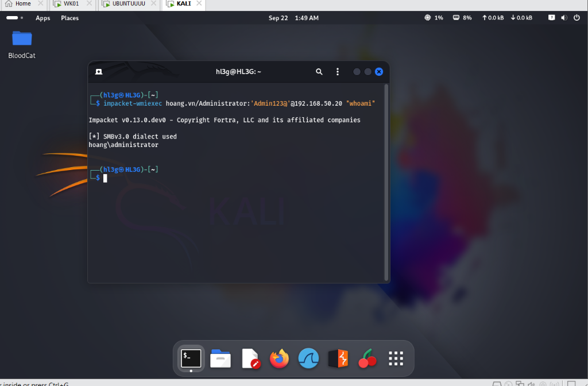
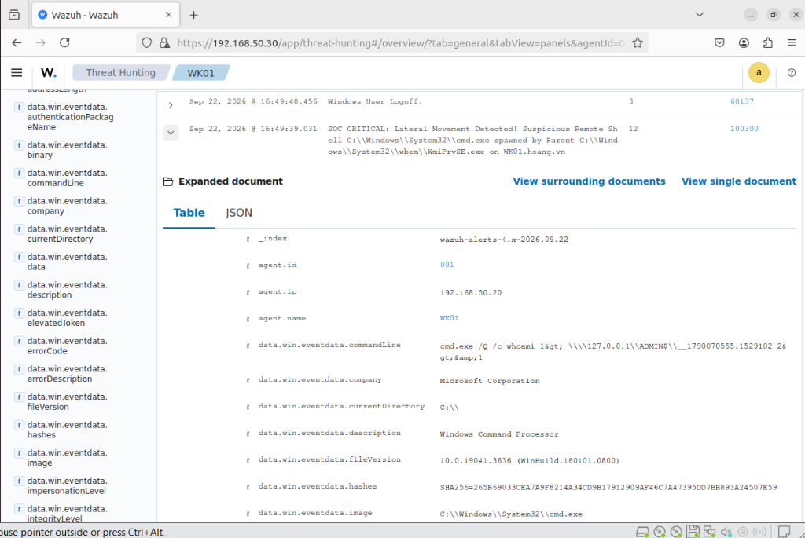
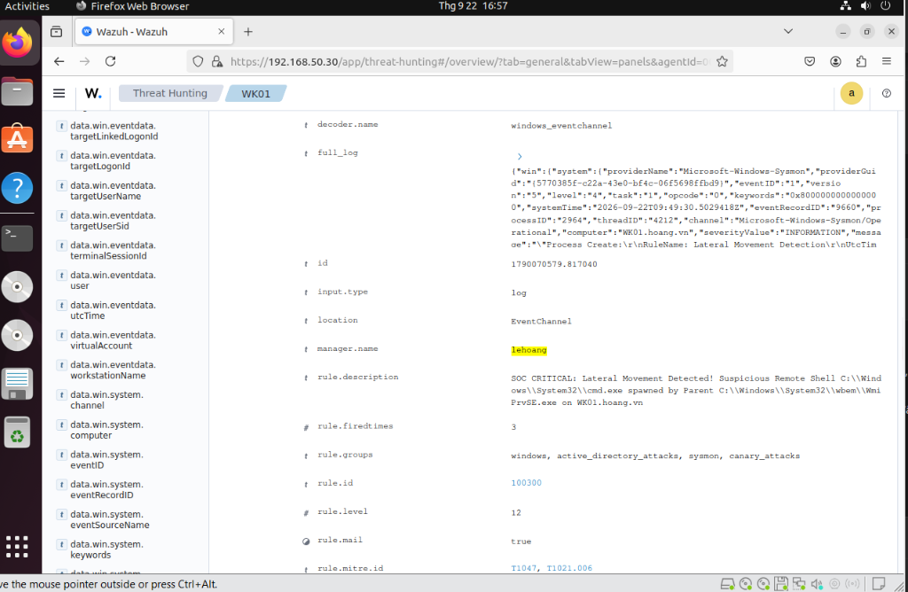
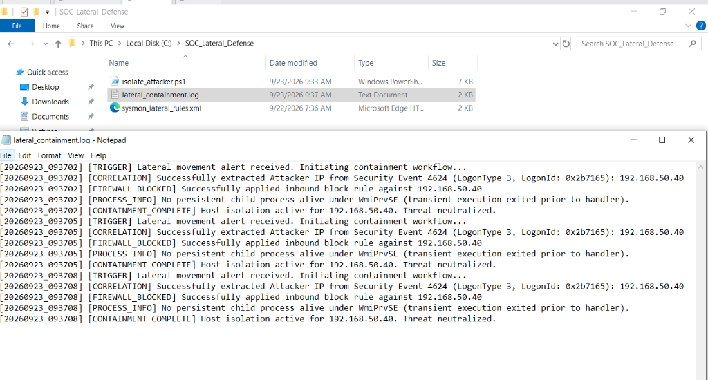
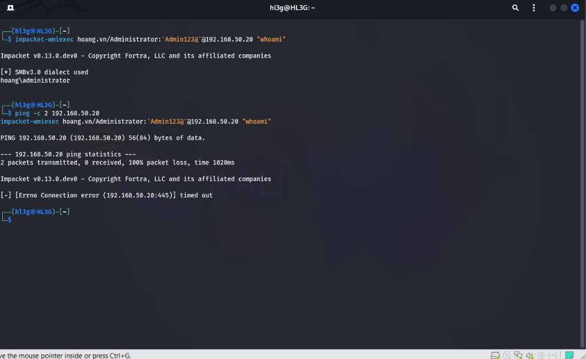

# Lateral Movement Detection and Source-IP Blocking

I used a WMI remote command to test process-lineage detection, then correlated its logon ID with Security Event 4624 to find the source IP for an inbound firewall block.

[Back to the lab](../README.md)

## Setup

| Host | Role | Address |
| --- | --- | --- |
| `WK01.hoang.vn` | Windows 10, Sysmon, Wazuh Agent 4.8 | `192.168.50.20` |
| `SIEM-SRV` | Ubuntu 22.04, Wazuh Manager 4.8 | `192.168.50.30` |
| `KALI` | Impacket WMI client | `192.168.50.40` |

Use the [Sysmon configuration](sysmon/sysmon_lateral_rules.xml), [Wazuh rule](wazuh/local_rules.xml) and [Active Response snippet](wazuh/ossec.conf.snippet). Security network-logon auditing must be enabled on the endpoint, and the Wazuh Agent must collect both Security and Sysmon EventChannel logs.

The response requires administrative access to the endpoint's Security log and NetSecurity firewall cmdlets. Place [block-lateral.cmd](soar/block-lateral.cmd) in the agent's Active Response `bin` directory and install [isolate_attacker.ps1](soar/isolate_attacker.ps1) at the path referenced by that wrapper.

If this endpoint also runs the canary scenario, merge both Sysmon configurations. Applying a standalone configuration can replace existing filters; retain the process-create coverage required by canary identity checks.

## Detection

Rule `100300` matches Sysmon Event 1 when `WmiPrvSE.exe` or `wsmprovhost.exe` starts a command shell or PowerShell. The rule uses executable-name boundaries so names such as `notcmd.exe` do not match.

This lineage can identify remote execution, including legitimate administration. Signed names and hashes alone do not establish intent. Review the command line, account, logon ID and source context.

## Response

The wrapper passes Wazuh JSON through STDIN. The handler requires Rule `100300`, Event 1, logon ID and event time. It looks for a Security Event 4624 network logon with the exact logon ID within the 60 seconds before that event and records the reported PID for audit.

Missing, ambiguous or conflicting correlation stops the response. There is no fallback to the newest network logon. Exclusions protect loopback, gateway and configured infrastructure addresses.

The handler applies and verifies an inbound block for one source IP using NetSecurity cmdlets. It audits the reported PID only; it does not kill other children of a WMI provider. Failures are logged rather than reported as successful containment.

The [Manager snippet](wazuh/ossec.conf.snippet) uses `local`, meaning the endpoint that generated the alert. `all` broadcasts to every agent, `server` targets the Manager, and `defined-agent` requires an explicit agent ID.

## Evidence

The recorded setup applied Sysmon and configured Active Response:





The initial WMI command succeeded and returned `hoang\administrator`:



Wazuh recorded `WmiPrvSE.exe -> cmd.exe` and matched rule `100300`:





The recorded handler extracted `192.168.50.40` and applied the inbound block:



```text
[20260923_093702] [TRIGGER] Lateral movement alert received. Initiating containment workflow...
[20260923_093702] [CORRELATION] Successfully extracted Attacker IP from Security Event 4624 (LogonType 3, LogonId: 0x2b7165): 192.168.50.40
[20260923_093702] [FIREWALL_BLOCKED] Successfully applied inbound block rule against 192.168.50.40
[20260923_093702] [PROCESS_INFO] No persistent child process alive under WmiPrvSE (transient execution exited prior to handler).
[20260923_093702] [CONTAINMENT_COMPLETE] Host isolation active for 192.168.50.40. Threat neutralized.
```

The log calls a source-IP block “Threat neutralized.” The subsequent ping loss and WMI timeout demonstrate blocking from that IP, not complete threat eradication:



These screenshots show the recorded WMI execution, source-IP block and connection checks.

## Testing

From the repository root:

```powershell
powershell -NoProfile -File tests\test_active_response.ps1
```

The assertions use mocked event and firewall results. Live testing must separately verify exact logon correlation, the resulting firewall rule and later connections from the test IP. The recorded transient `cmd.exe` had already exited when inspected; its absence alone is not containment evidence.

## Limits

The 60-second window can miss older sessions. Exact logon-ID matching reduces ambiguity but does not establish that every remote command is malicious. Concurrent administration and alternate authentication paths need separate testing.

An inbound rule for one IP is not full host isolation. Other source addresses, established access paths and affected hosts remain separate investigation targets. Block lifetime and removal need an operational policy.
