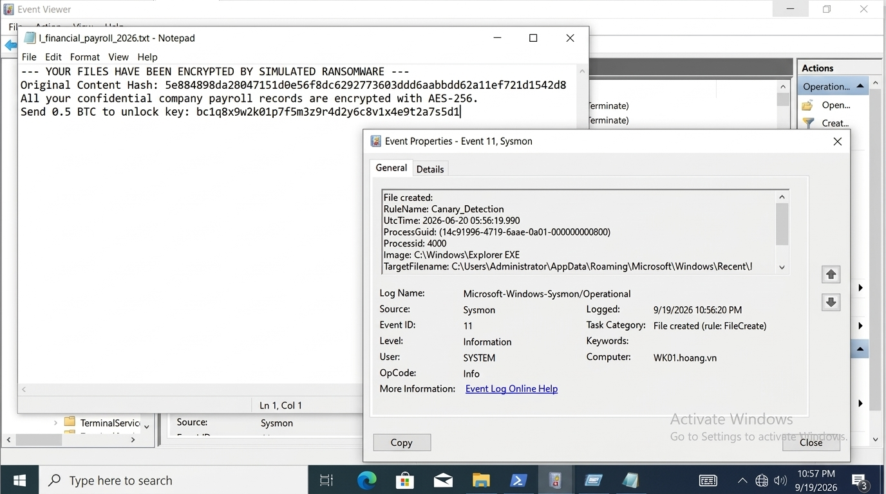
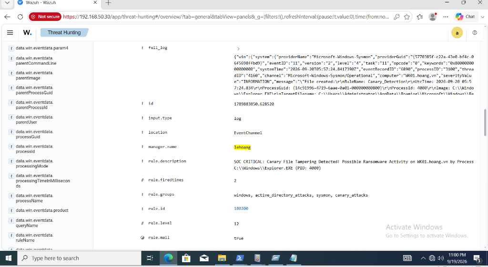
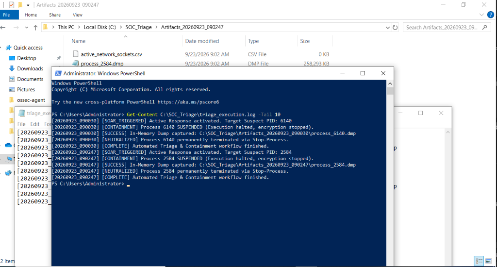
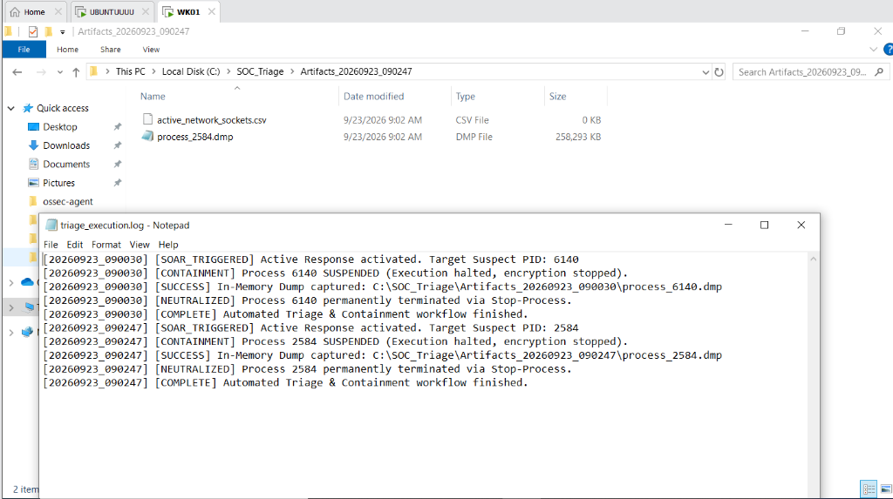

# Canary File Detection and Process Triage

I used a decoy TXT file to test Sysmon-to-Wazuh detection and process evidence collection. The current simulator is a single harmless file write, with no encryption, directory traversal or ransom note.

[Back to the lab](../README.md)

## Setup

| Host | Role | Address |
| --- | --- | --- |
| `WK01.hoang.vn` | Windows 10, Sysmon and Wazuh Agent 4.8 | `192.168.50.20` |
| `SIEM-SRV` | Ubuntu 22.04, Wazuh Manager 4.8 | `192.168.50.30` |

Use the [Sysmon configuration](sysmon/sysmon_canary_config.xml), [Wazuh rule](wazuh/local_rules.xml) and [Active Response snippet](wazuh/ossec.conf.snippet). Collect `Microsoft-Windows-Sysmon/Operational` through the Windows Agent.

Sysmon records canary FileCreate events and all process starts through an empty `ProcessCreate onmatch="exclude"` filter. There are no writer exclusions: legitimate writes remain visible for review. The process-start record must be retained for identity checking.

Merge this configuration with the [lateral telemetry configuration](../lateral-movement-containment/sysmon/sysmon_lateral_rules.xml) when using both on one host. Applying one standalone configuration can replace the other's filters.

Place [canary-triage.cmd](triage/canary-triage.cmd) in the agent's Active Response `bin` directory. Install [triage_soar_handler.ps1](triage/triage_soar_handler.ps1) at the wrapper's configured path. Opted-in collection also requires `procdump.exe` in the handler's triage root and enough protected storage for a full process dump.

## Detection

Rule `100200` requires the exact protected basename `!_financial_payroll_2026.txt` or `!_confidential_contract.txt`. A `.txt.lnk` shortcut or suffix lookalike does not match that scope.

A TXT write is a file-activity signal, not proof of ransomware. Explorer, security software and other legitimate processes can create these files. The [companion quality lab](https://github.com/LeeHoang26/wazuh-detection-quality-lab) records the shortcut false positive, offline comparison and live detection-only TXT copy.

## Response

The default is a logged review decision. Process actions require `CANARY_ENABLE_RESPONSE=true` in the handler's environment; the companion live detection test kept Active Response disabled.

The wrapper passes Wazuh JSON through STDIN. The handler requires Rule `100200`, Event 11, PID, ProcessGuid, image and `UtcTime`. It matches those fields to Sysmon Event 1 and the live process creation time before acting. It pins the process handle to reduce PID-reuse risk rather than choosing the newest matching filename event.

With response enabled, the handler checks ProcDump availability, suspends the selected process through a native API call, records sockets and executable SHA-256, captures a full dump, and attempts termination. Return statuses, dump creation and termination are checked explicitly.

If collection fails after suspension, the selected process remains suspended for review. The failure is logged; an operator must decide whether to resume or terminate it. Missing or conflicting identity stops the response before process actions.

The Manager snippet uses `local` for the agent that generated the alert. `all` broadcasts to every agent, `server` targets the Manager, and `defined-agent` requires an explicit agent ID.

## Evidence

The recorded simulator run modified `!_financial_payroll_2026.txt` and generated Sysmon Event 11:



Wazuh matched rule `100200` and recorded the endpoint, image, PID and target fields:




The recorded response shows suspension, ProcDump and termination on `WK01`:



The screenshots show a 258 MB dump and artifacts for PIDs `6140` and `2584`, with log entries for suspension, dump capture and termination:



Artifacts include `process_<PID>.dmp`, TCP connection metadata and executable SHA-256 under `C:\SOC_Triage`. These are evidence for later analysis; no encryption-key recovery is demonstrated.

## Testing

From the repository root:

```powershell
powershell -NoProfile -File tests\test_active_response.ps1
```

The assertions use mocked telemetry and process operations. The [marker script](simulator/ransomware_sim.ps1) is a separate live detection check for an isolated lab. Its default target is an existing disposable `C:\Users\Administrator\Desktop\!_financial_payroll_2026.txt`; it writes a marker, waits 30 seconds and exits. Start with response disabled, inspect Event 11, then verify the matching alert and its fields in Wazuh.

## Limits

Suspending one process may limit its further writes; parallel processes and already completed writes remain outside the handler's control. A process dump may contain useful volatile data but does not prove usable encryption keys or complete containment.

Process identity checks require Sysmon Event 1, sufficient event retention and access to the live process. Dumps can be large and sensitive; storage capacity and access controls need planning. Neither two recorded dumps nor mocked assertions establish safety across other workloads.
